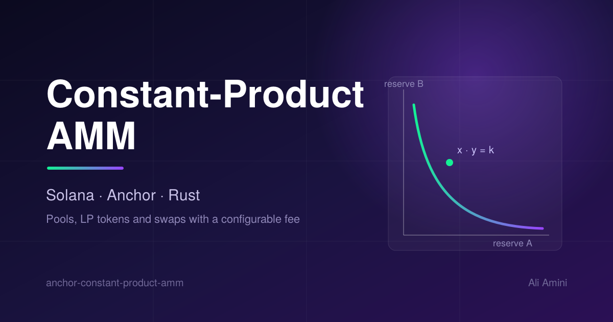

# amm_cp — Constant-Product AMM on Solana (Rust + Anchor)



A minimal but complete **constant-product automated market maker** (the `x * y = k`
model used by Uniswap v2) written as a Solana program in **Rust** with the
**Anchor** framework.

Each pool is a Program-Derived Address (PDA) that owns its two token vaults and
its LP mint, so the pool itself signs every transfer and mint via its PDA seeds.
Liquidity providers deposit both tokens and receive LP tokens; traders swap one
token for the other, paying a configurable fee that stays in the pool and accrues
to LPs.

This repository is a portfolio project. It is deployed to **devnet only** and is
**unaudited** — see *Security considerations* below.

## Features

- Create a pool for any ordered pair of SPL mints with a configurable swap fee.
- Add liquidity with automatic optimal-ratio matching; first deposit mints
  `sqrt(amount_a * amount_b)` LP tokens.
- Remove liquidity for a proportional share of both reserves.
- Swap in either direction along the constant product, with a fee on the input.
- Slippage protection (`min_lp_out`, `min_amount_out`, `min_amount_a/b`) on every
  user-facing instruction.
- Checked integer math throughout (`u128` intermediates, explicit overflow errors).

## Program interface

Program ID (default keypair in `target/deploy/`): `AdvuNWNdKBhLx3FqAaHeHcMoXKV7Jxw5Ez9pw2Xns5Vo`

| Instruction        | Description                                                        |
| ------------------ | ------------------------------------------------------------------ |
| `initialize_pool`  | Create the pool PDA, its two vaults and the LP mint; set the fee.  |
| `add_liquidity`    | Deposit token A and token B, receive LP tokens.                    |
| `remove_liquidity` | Burn LP tokens, withdraw the proportional share of both reserves.  |
| `swap`             | Swap `amount_in` of one token for the other (`a_to_b: bool`).      |

### Accounts and PDAs

- `Pool` — state account, PDA of `["pool", mint_a, mint_b]`. Stores the mints,
  vaults, LP mint, fee (bps) and its own bump. It is also the authority over the
  vaults and the LP mint.
- `vault_a` / `vault_b` — token accounts, PDAs of `["vault_a"|"vault_b", pool]`.
- `lp_mint` — LP mint, PDA of `["lp_mint", pool]`.

Mints are stored in canonical order (`mint_a < mint_b`) so there is exactly one
pool per unordered pair.

### Swap math

```
amount_in_after_fee = amount_in * (FEE_DENOMINATOR - fee_bps) / FEE_DENOMINATOR
amount_out          = reserve_out * amount_in_after_fee / (reserve_in + amount_in_after_fee)
```

Rounding is floor throughout, which always rounds in the pool's favour.

## Tech stack

- Rust, Anchor `0.31.1`
- Solana CLI (Agave) `4.3.1`, platform-tools (rustc `1.84.1`)
- `anchor-spl` for the SPL Token CPIs
- TypeScript integration tests (`@coral-xyz/anchor`, `@solana/spl-token`, Mocha/Chai)

## Build, test, deploy

```bash
# Build the program and generate the IDL + TS types
anchor build

# Rust unit tests (math)
cargo test -p amm_cp --lib

# Full integration tests against a local validator
anchor test
# ...or, against a validator you started yourself:
solana-test-validator --reset &
anchor test --skip-local-validator

# Deploy to devnet (fund the wallet first)
solana config set --url devnet
solana airdrop 3            # or fund via https://faucet.solana.com
anchor deploy --provider.cluster devnet
```

After deploying, the program is viewable on Solana Explorer:
`https://explorer.solana.com/address/<PROGRAM_ID>?cluster=devnet`

## Test results

```
  amm_cp — constant-product AMM
    ✔ initializes a pool
    ✔ adds initial liquidity (LP = sqrt(a*b))
    ✔ swaps A for B along the constant product
    ✔ removes liquidity proportionally
    ✔ rejects a swap that violates slippage
  5 passing

  running 3 tests (cargo)
    test math::tests::amount_out_matches_formula ... ok
    test math::tests::sqrt_works ... ok
    test test_id ... ok
```

## Security considerations and limitations

This is a learning / portfolio project, **not** production-ready code. Known
simplifications, stated plainly:

- **Unaudited, devnet only.** Do not deploy to mainnet or use with real funds.
- **No minimum-liquidity lock.** Uniswap v2 permanently locks the first
  `MINIMUM_LIQUIDITY` LP tokens to blunt the first-depositor share-inflation
  attack. This program omits that; a production version should add it.
- **No protocol fee or TWAP oracle.** The entire fee accrues to LPs; there is no
  on-chain price accumulator.
- **Token-2022 / transfer-fee mints are not handled.** The program assumes the
  classic SPL Token program and fee-free mints.
- Integer rounding always favours the pool, which is the safe direction, but
  tiny amounts can round to zero and are rejected.

## Author

Ali Amini
